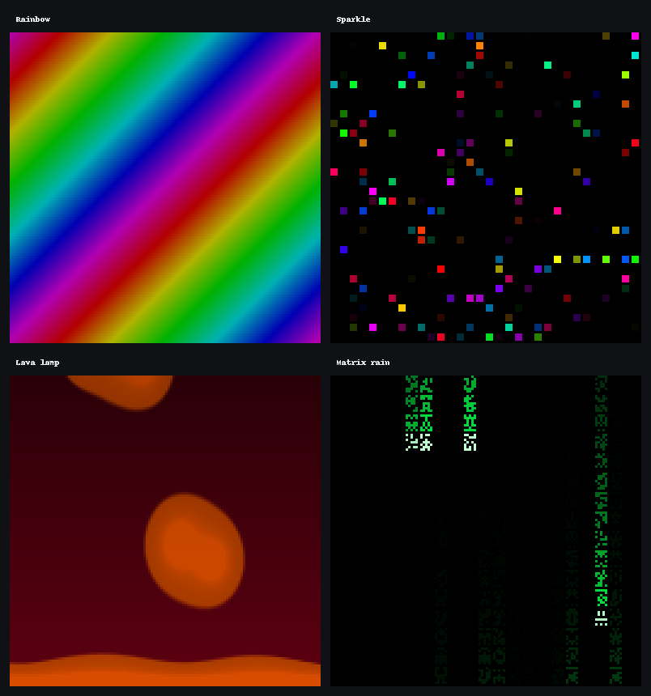

# Spectra LED Matrix

Open-source control software for large **HUB75 RGB LED matrix** walls and
standalone mini clocks — FastAPI UIs, Ansible deploy, MQTT captions, and a
library of clocks, weather, media, and procedural animations.

This repository is the **public** Spectra project. Site-specific inventory,
secrets, and hostnames stay out of git (see [`SECURITY.md`](SECURITY.md)).

## See it in action

Procedural modes (nearest-neighbour upscaled from a 128×128 canvas):



| [Rainbow](docs/previews/rainbow.png) | [Sparkle](docs/previews/sparkle.png) | [Lava lamp](docs/previews/lava_lamp.png) | [Matrix rain](docs/previews/matrix_rain.png) |
| :---: | :---: | :---: | :---: |
| Colour bands corner-to-corner | Blinkenlights | Metaball wax | Falling glyphs |

Live demos:

| Video | Link |
| --- | --- |
| Mini panel → dual wall walkthrough | [Watch](https://youtu.be/w0ZgrCWmPL4) |
| Sparkle, matrix rain & lava lamp | [Short](https://youtube.com/shorts/bsfv5x9dP8c) |
| Sparkle & lava lamp | [Short](https://youtube.com/shorts/wsMO1CcpWjs) |
| Rainbow & matrix rain | [Short](https://youtube.com/shorts/Oy9IgHbI8sE) |

Hardware in the Shorts: **P2.5** 64×64 panels in groups of **9** (3 chains × 3) per
wall, each wall driven by a **Raspberry Pi 4 + Electrodragon** HUB75 board;
**Raspberry Pi 5** runs the controller / orchestrator.

## Major features

### Display modes (each matrix host)

| Mode | What it does |
| --- | --- |
| **Weather** | Local forecast, time, humidity; monthly calendar on 192×192 |
| **World clock** | Multiple time zones (compact BDF layout built-in; optional large-wall renderer via `repo_urls.world_clock`) |
| **Analog clock** | Face with sweeping second hand |
| **Game of Life** | Full-panel Conway simulation |
| **Flame / Lava** | Procedural fire (sparse or dense); colour themes + intensity |
| **Starfield** | Win95-style fly-through; colour modes + night intensity |
| **Matrix rain** | Falling glyphs; colour presets or custom colour, four speeds |
| **Rainbow** | Diagonal colour bands; palettes, direction, speed, brightness |
| **Sparkle** | Blinkenlights — twinkle or blink, pixels or lamps |
| **Lava lamp** | Metaball wax blobs; wax / liquid colours, speed, blob count |
| **Media** | Full-screen GIF (in-process) or MP4 via hzeller `video-viewer` |

### Overlays & scheduling

- **MQTT overlay** — temporary captions (Whisper, Meshtastic, and optional `custom/#` topics)
- **Custom messages** — 1–3 line scheduled text with live preview sizes
- **Night dim** — brightness steps by time of day

### Controller dashboard (optional Pi 5)

- Sync both walls or control each host at `:8090`
- Per-wall colour / speed panels for fire, starfield, rain, rainbow, sparkle, lava lamp
- Whisper on/off, purge queue, health, MQTT test, self-test
- Custom message editor with 192×192 / 64×64 / 64×48 preview

### Deploy & form factors

- **Dual wall** — two Pi 4s × 9 panels (192×192 each) + Pi 5 controller
- **Mini-Spectra Clock** — one Pi 4 + Adafruit HAT + 1–4 panels, standalone Ansible playbook
- Per-device `matrix.local.json` for geometry, driver board, and brightness ceiling

## Framework & stack

| Layer | Choice |
| --- | --- |
| Language | Python 3 |
| Wall / orchestrator APIs | [FastAPI](https://fastapi.tiangolo.com/) + Uvicorn |
| LED driver | [hzeller/rpi-rgb-led-matrix](https://github.com/hzeller/rpi-rgb-led-matrix) (GPIO + `video-viewer`) |
| Imaging | Pillow, NumPy |
| Messaging | MQTT (Mosquitto) |
| Deploy | Ansible (controller → walls; or laptop → mini clock) |
| Speech (optional) | faster-whisper / NPU offload bridge |
| Mesh (optional) | Meshtastic → MQTT bridge |
| Weather | OpenWeatherMap (API key in gitignored secrets) |

Display modes are pluggable classes (`setup` / `tick` / `teardown`) registered in
`display/modes/registry.py`. Procedural effects share a common config + UI panel
(`effect_config` / `web/effect_ui.py`).

## Hardware (reference build)

| Piece | Reference |
| --- | --- |
| Panels | [Adafruit #3649](https://www.adafruit.com/product/3649) 64×64, 2.5 mm, 1/32 scan (ABCDE) |
| Dual wall | 9 panels per wall → **192×192** canvas × 2 |
| Matrix Pis | Raspberry Pi 4 (8 GB) + **Electrodragon** HUB75 board |
| Controller | Raspberry Pi 5 (8 GB) + Mosquitto + orchestrator |
| Power | High-current **5 V** supply for panels (plan ~4 A/panel at full white) |
| Mini clock | Pi 4 + **Adafruit RGB Matrix HAT/Bonnet** + 1–4 panels |
| Optional | ReSpeaker mic, Meshtastic USB radio, GPS HAT, Radxa Q6A Whisper offload |

Topology sketch and BOM: [`docs/HARDWARE.md`](docs/HARDWARE.md),
[`docs/PARTS_AND_COSTS.md`](docs/PARTS_AND_COSTS.md).

```
Pi 5 controller (:8090, MQTT) ──ethernet──► Pi 4 upper wall (:8080)
                          └──ethernet──► Pi 4 lower wall (:8080)
```

## Quick start (single matrix host)

```bash
git clone https://github.com/kaerka/spectra-led-matrix.git
cd ~/spectra-led-matrix

# hzeller rgbmatrix bindings (not vendored — build once per Pi):
git clone https://github.com/hzeller/rpi-rgb-led-matrix.git
cd rpi-rgb-led-matrix && make build-python PYTHON=$(which python3)
cd ..

export PYTHONPATH=~/spectra-led-matrix/rpi-rgb-led-matrix/bindings/python

python3 -m venv .venv
source .venv/bin/activate
pip install -r requirements.txt

cp config/secrets.example.json config/secrets.local.json      # API key, city, NTP
cp config/display_state.example.json config/display_state.json
cp config/mqtt.example.json config/mqtt.local.json              # optional
cp config/brightness_schedule.example.json config/brightness_schedule.local.json
cp config/matrix.example.json config/matrix.local.json          # panel geometry

sudo -E env PYTHONPATH=$PYTHONPATH .venv/bin/python run.py
```

Browse `http://<pi-ip>:8080/`.

## Quick start (controller + walls)

```bash
cd ansible
cp inventory/hosts.example.yml inventory/hosts.yml   # your hostnames / IPs
ansible-playbook playbooks/site.yml -i inventory/hosts.yml
```

Orchestrator: `http://<controller>:8090/`. Details:
[`docs/ORCHESTRATION.md`](docs/ORCHESTRATION.md).

## Quick start (Mini-Spectra Clock)

```bash
cd ansible
# Add the Pi under mini_clocks in hosts.yml, then:
ansible-playbook playbooks/mini-clocks.yml -i inventory/hosts.yml
```

Puts the OpenWeatherMap key in `/data/spectra/config/secrets.local.json` and open
`http://<mini>:8080/`.

## Repository layout

```
run.py              Matrix host entry (web + display runner)
display/            Modes, matrix config, MQTT overlay, state
web/                FastAPI control panel (:8080)
orchestrator/       FastAPI dashboard (:8090)
bridges/            Whisper + Meshtastic → MQTT
ansible/            Deploy playbooks and roles
config/             *.example.json templates (locals gitignored)
docs/               Architecture, hardware, orchestration, BOM
systemd/            Example service unit
```

## Documentation

| Doc | Contents |
| --- | --- |
| [`docs/ARCHITECTURE.md`](docs/ARCHITECTURE.md) | Processes, data paths, trust model |
| [`docs/HARDWARE.md`](docs/HARDWARE.md) | Panels, Pis, power, optional extras |
| [`docs/ORCHESTRATION.md`](docs/ORCHESTRATION.md) | Ansible playbooks |
| [`docs/PARTS_AND_COSTS.md`](docs/PARTS_AND_COSTS.md) | BOM & rough cost |
| [`docs/DATA_LAYOUT.md`](docs/DATA_LAYOUT.md) | `/data/spectra` tree |
| [`SECURITY.md`](SECURITY.md) | LAN-trust defaults and hardening |

## Related projects

| Project | Role |
| --- | --- |
| [hzeller/rpi-rgb-led-matrix](https://github.com/hzeller/rpi-rgb-led-matrix) | GPIO driver and `video-viewer` (GPL-2.0+, built locally) |
| [ChuckBuilds/ledmatrix-plugins](https://github.com/ChuckBuilds/ledmatrix-plugins) | Community plugin store for the LEDMatrix stack — a good place to share ported animations |

### Contributing animations to LEDMatrix plugins

Spectra modes are plain Python + NumPy/Pillow classes. ChuckBuilds’ store expects
a different plugin API (`manifest.json`, `manager.py`, size harness) and is
**GPL-3.0**. Porting rainbow / sparkle / lava lamp / matrix rain there is
worthwhile for reach, but:

1. Relicense the **ported** plugin code under GPL-3.0 (Spectra itself stays MIT).
2. Target their size matrix (often 64×32 / 128×64-class panels, not only square 64/192).
3. Follow [`SUBMISSION.md`](https://github.com/ChuckBuilds/ledmatrix-plugins/blob/main/SUBMISSION.md)
   (manifest, README screenshots, `plugins.json` entry, CI harness).

We can carve out a small GPL-friendly plugin package from these modes when you’re
ready to open a PR.

## License

MIT — see [`LICENSE.md`](LICENSE.md). Includes attribution for Adafruit examples,
Pimoroni Galactic Unicorn fire, and third-party dependencies.
